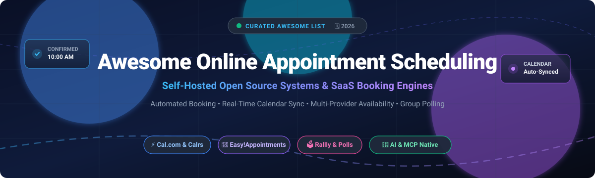

  

# 🗓️ Awesome Online Appointment Scheduling

       

> 📌 **A curated list of top Online Appointment Scheduling and Calendar Booking software** — featuring SaaS/hosted commercial platforms and self-hosted open-source alternatives for client self-service booking, calendar synchronization, automated reminders, and workflow automation.
>
> 🌟 *Star this repository if you find it helpful!* 🌟

---

## 📋 Table of Contents

- [🌐 Sector Overview & Market Dynamics](#-sector-overview--market-dynamics)
- [🟦 SaaS / Hosted Platforms](#-saas--hosted-platforms)
- [🟩 Open-Source Software](#-open-source-software)
- [📊 Feature Comparison Matrix](#-feature-comparison-matrix)
- [🎯 Selection Guide](#-selection-guide)
- [🌟 Star History](#-star-history)
- [💖 Support](#-support)
- [🤝 Contributing](#-contributing)
- [📄 License](#-license)

---

## 🌐 Sector Overview & Market Dynamics

The global appointment scheduling software market is valued at approximately **$450 million to $550 million** and is projected to expand at a compound annual growth rate (CAGR) of **10% to 14%**, reaching over **$1.2 billion** within the decade. The sector is **moderately fragmented**: while powerhouse ecosystems and established brands (Square, Squarespace/Acuity, Calendly, Zoho) command high consumer awareness, low technical barriers to entry and hyper-specific vertical demands (healthcare clinics, salons, education, professional services) allow numerous niche SaaS players and self-hosted open-source solutions to thrive alongside major platforms.

---

## 🟦 SaaS / Hosted Platforms

Commercial, cloud-hosted Online Appointment Scheduling solutions. The table below is sorted in descending order by company size (valuation / annual revenue).

| 🏢 Platform | 💰 Company Size (Valuation / Revenue) | 🏷️ Starting Pricing (Paid Tiers) | 🎁 Free Tier / Trial Limits | ✨ Key Strengths & Focus |
|:---|:---|:---|:---|:---|
| **[Square Appointments](https://squareup.com/appointments)** | **$52B+ Market Cap** / ~$24.2B Revenue (Block, Inc.) | **$49/month** per location (Plus plan; 2.5% + 10¢ per in-person transaction) | **Free forever plan**: Unlimited staff calendars, basic booking website, automated SMS/email reminders; no advanced no-show protection/deposits; transaction fees apply (2.6% + 15¢ in-person) | 🛒 Built into Square POS & payments ecosystem; ideal for salons, spas, and service retail businesses |
| **[Zoho Bookings](https://www.zoho.com/bookings/)** | **~$12.5B Valuation** / ~$1.4B–$1.5B Revenue (Zoho Corp) | **$6/user/month** (billed annually) or $8/user/month (Basic plan) | **Free forever plan**: Strictly limited to 1 user, 1 workspace, 1 service/event type, and 1 calendar connection; includes automated email reminders but no online payment processing | 🔄 Deep integration with Zoho CRM, Zoho Meeting, and broader Zoho business application ecosystem |
| **[Acuity Scheduling](https://acuityscheduling.com/)** | **$7.2B Valuation** (Acquired by Squarespace / Permira) / ~$1B+ Revenue | **$16/month** (billed annually) or $20/month (Starter plan; 1 calendar) | **No free-forever plan**: Offers a **7-day free trial** with access to core booking features; after trial, requires upgrading to a paid plan ($16+/mo) | 📋 Advanced client intake forms, subscription/package booking, automated reminders, and payment gateway support |
| **[Calendly](https://calendly.com/)** | **$3B Valuation** / ~$140M–$270M ARR | **$10/user/month** (billed annually) or $12/user/month (Standard plan) | **Free forever plan**: Limited strictly to 1 active event type, 1 calendar connection, 1-on-1 meetings only; Calendly branding mandatory; no payment integration | 🎯 Market leader in self-service 1-on-1 link scheduling, automated routing, and team availability coordination |
| **[YouCanBookMe](https://youcanbook.me/)** | **~$20M–$40M Valuation** (Est.) / ~$5M ARR | **$8.10/month** (billed annually) or $9/month (Individual plan) | **Free forever plan**: Limited to 1 linked calendar, 1 booking page, and maximum 7 booking form questions; forces "Powered by YouCanBookMe" badge | 📅 Streamlined calendar booking with flexible scheduling rules, configurable notifications, and team grids |
| **[SimplyBook.me](https://simplybook.me/)** | **~$12M–$35M Valuation** (Est.) / ~$3M–$5M ARR | **$11.90/month** (billed annually) or $13.90/month (Basic plan; 100 bookings, 3 custom features) | **Free forever plan**: Capped strictly at 50 bookings per month, 1 service provider/staff member, 1 custom feature plugin, and 1 mini website/widget | 🧩 Modular plugin architecture, client directory, multi-location support, and extensive marketplace add-ons |

---

## 🟩 Open-Source Software

Self-hosted, community-driven appointment scheduling software and calendar coordination tools. Sorted in descending order by GitHub Stars_Count.

### 1. [Cal.com](https://github.com/calcom/cal.com) 
* **🛠️ Stack:** TypeScript / Next.js / PostgreSQL / Prisma / Tailwind CSS | **⚖️ License:** AGPLv3 (Open-core)
* **📖 Overview:** Cal.com is the leading open-source scheduling infrastructure and primary open alternative to Calendly. It provides complete booking management, team scheduling (round-robin and collective), customizable booking questions, custom availability schedules, and extensive app integrations (Google Calendar, Outlook, Zoom, Stripe, CalDAV).
* **🚀 Self-Hosting:** Official Docker Compose configurations with PostgreSQL and Traefik support; also available as an embeddable React/Web Component library.
* **🎯 Best For:** Teams and developers seeking a modern, enterprise-ready scheduling engine with workflow automation and full data control.

### 2. [Rallly](https://github.com/lukevella/rallly) 
* **🛠️ Stack:** TypeScript / Next.js / tRPC / Prisma / PostgreSQL | **⚖️ License:** AGPL-3.0
* **📖 Overview:** Rallly is a privacy-first, open-source meeting poll and group scheduling platform built as a direct alternative to Doodle. Rather than 1-on-1 self-booking links, it empowers teams and groups to vote on mutually compatible dates and time slots without forcing respondents to create accounts.
* **🚀 Self-Hosting:** Deploys via Docker and Docker Compose; supports custom branding, SSO authentication (OIDC, Microsoft Entra, Google), and exportable ICS calendar invites.
* **🎯 Best For:** Finding common meeting times across distributed groups, board members, and external stakeholders without sign-up friction.

### 3. [Easy!Appointments](https://github.com/alextselegidis/easyappointments) 
* **🛠️ Stack:** PHP / MySQL / jQuery / Bootstrap | **⚖️ License:** GPL-3.0
* **📖 Overview:** In continuous development since 2014 with over 220,000 release downloads, Easy!Appointments is the benchmark self-hosted appointment scheduler for service businesses. It provides customer self-booking pages, multiple providers and services, custom working plans, Google Calendar two-way synchronization, and LDAP authentication.
* **🚀 Self-Hosting:** Runs on standard LAMP/LEMP stacks, shared web hosts, or official Docker containers; includes CMS plugins for WordPress, Joomla, and Drupal.
* **🎯 Best For:** Small-to-mid medical practices, salons, educational tutors, and non-profits wanting a mature, reliable multi-provider booking platform without recurring seat fees.

### 4. [Someday](https://github.com/rbbydotdev/someday) 
* **🛠️ Stack:** TypeScript / React / Vite / Shadcn UI / Google Apps Script | **⚖️ License:** MIT
* **📖 Overview:** Someday is a 100% free-to-host calendar availability picker and minimalist Calendly alternative tailored specifically for Google Workspace and Gmail users. It interfaces directly with Google Apps Script to read and block availability without requiring an external backend or database.
* **🚀 Self-Hosting:** Zero hosting costs; deploys directly via Google Apps Script and static web hosting (Vercel/Netlify/GitHub Pages).
* **🎯 Best For:** Solopreneurs and Google Workspace users seeking an ultra-lightweight, zero-cost booking picker without server maintenance.

### 5. [Thunderbird Appointment](https://github.com/thunderbird/appointment) 
* **🛠️ Stack:** Python / Vue.js / CalDAV / Matrix | **⚖️ License:** MPL-2.0
* **📖 Overview:** Created under the Mozilla/Thunderbird umbrella, Thunderbird Appointment is an open, standards-compliant appointment booking tool focused on privacy, user autonomy, and native CalDAV calendar integration.
* **🚀 Self-Hosting:** Standard containerized deployment with integration into self-hosted CalDAV providers (Nextcloud, Radicale, Baïkal).
* **🎯 Best For:** Privacy-focused individuals and organizations committed to open communication protocols and open-source email/calendar workflows.

### 6. [Calrs](https://github.com/olivierlambert/calrs) 
* **🛠️ Stack:** Rust / Axum / PostgreSQL / CalDAV | **⚖️ License:** AGPL-3.0
* **📖 Overview:** Calrs is a blazingly fast, lightweight scheduling platform written in Rust. It delivers team scheduling with round-robin or collective meeting coordination, multi-timezone slot calculations, CalDAV integration, and OIDC/Keycloak authentication.
* **🚀 Self-Hosting:** Extremely low memory footprint; single native binary or lean Docker container.
* **🎯 Best For:** High-performance infrastructure environments, privacy advocates, and self-hosters prioritizing system resource efficiency and CalDAV compliance.

### 7. [Tymeslot](https://github.com/Tymeslot/tymeslot) 
* **🛠️ Stack:** Elixir / Phoenix LiveView / PostgreSQL | **⚖️ License:** AGPL-3.0
* **📖 Overview:** Tymeslot is a modern, real-time Calendly alternative built with Elixir and Phoenix LiveView. It supports 2-way sync across Google Calendar, Outlook, iCloud, and any CalDAV instance (Nextcloud, Zimbra, Radicale), automatic meeting room generation (Google Meet, Teams, Zoom, Jitsi, Nextcloud Talk), and Stripe-powered booking payments.
* **🚀 Self-Hosting:** Packaged as an all-in-one Docker image (bundled PostgreSQL option available) for fast, zero-fuss deployments.
* **🎯 Best For:** Users seeking a reactive, real-time booking user experience with comprehensive CalDAV and video conference integration.

### 8. [Django-Appointment](https://github.com/adamspd/django-appointment) 
* **🛠️ Stack:** Python / Django / SQLite / PostgreSQL | **⚖️ License:** MIT
* **📖 Overview:** A plug-and-play Django application that equips any existing Python/Django web application with complete appointment scheduling capabilities. Supports custom staff schedules, slot duration settings, email alerts, and administrative override dashboards.
* **🚀 Self-Hosting:** Installed via `pip install django-appointment` and added to `INSTALLED_APPS`.
* **🎯 Best For:** Python/Django developers building portals, SaaS apps, or client dashboards who need an embedded booking engine without running a standalone server.

### 9. [Calnode](https://github.com/Calnode/calnode) 
* **🛠️ Stack:** Go / SQLite / Model Context Protocol (MCP) | **⚖️ License:** Apache-2.0
* **📖 Overview:** Calnode is an API-first, single-binary scheduling engine built with Go and SQLite. Uniquely, it features a native Model Context Protocol (MCP) server baked directly into the binary, allowing autonomous AI agents to query availability and book appointments deterministically.
* **🚀 Self-Hosting:** Zero external dependencies; single executable binary with SQLite database storage.
* **🎯 Best For:** AI engineers and automators wanting an ultra-lightweight, scriptable scheduling engine callable by LLM agents.

### 10. [OpenCalendar](https://github.com/kudretyilmazz/opencalendar) 
* **🛠️ Stack:** Next.js / TypeScript / PostgreSQL / Docker | **⚖️ License:** AGPL-3.0
* **📖 Overview:** A modern open-core alternative to Cal.com and Calendly crafted with strict web accessibility (WCAG 2.2 AA). It includes multi-user team scheduling, routing forms, webhooks, and calendar synchronizations without gated paywalls.
* **🚀 Self-Hosting:** Straightforward Docker configuration requiring only PostgreSQL (no Redis required).
* **🎯 Best For:** Organizations seeking a clean open-source scheduling solution with full accessibility compliance and transparent licensing.

### 11. [Tidetime](https://github.com/Sulaiman-Dauda/Tidetime) 
* **🛠️ Stack:** Next.js 16 / React 19 / TypeScript / PostgreSQL / Drizzle ORM | **⚖️ License:** MIT
* **📖 Overview:** An open-source scheduling system customized for a single company operating with multiple services and staff providers. Features least-busy auto-assignment, transaction-safe booking reservations, Google Calendar/Microsoft 365 sync, and automated Caddy HTTPS domains.
* **🚀 Self-Hosting:** Containerized deployment with Docker and Caddy reverse proxy.
* **🎯 Best For:** Small business service agencies, dental/medical offices, and consulting firms managing internal teams.

### 12. [Just-Book-My-Cal](https://github.com/mxmehl/just-book-my-cal) 
* **🛠️ Stack:** Python / Flask / ICS / SQLite | **⚖️ License:** Apache-2.0
* **📖 Overview:** A lightweight, self-hosted booking page that reads busy slots directly from any published `.ics` calendar URL. Does not require OAuth app approval or cloud calendar APIs; simply ingest your private calendar feed, compute open slots, and dispatch invitations.
* **🚀 Self-Hosting:** Available on PyPI (`pip install justbookmycal`) and deployed with Gunicorn or systemd.
* **🎯 Best For:** Individuals looking for a private, zero-bloat personal booking link powered entirely by standard iCalendar feeds.

---

## 📊 Feature Comparison Matrix

| 💻 Software | ⚖️ License | 🛠️ Primary Stack | 👥 Multi-Provider | 📅 CalDAV / ICS | 🔄 Two-Way Sync | 🚢 Best Deployment Model |
|:---|:---|:---|:---:|:---:|:---:|:---|
| **Cal.com** | AGPLv3 (Open-core) | Next.js / PostgreSQL | ✅ | ✅ | ✅ | Docker / Cloud |
| **Rallly** | AGPL-3.0 | Next.js / PostgreSQL | (Polling) | ✅ (Export) | ❌ | Docker / Railway |
| **Easy!Appointments** | GPL-3.0 | PHP / MySQL | ✅ | ❌ | ✅ Google | LAMP / Docker / WP |
| **Someday** | MIT | React / Google Apps Script | ❌ | ❌ | ✅ Google | Serverless / Static Host |
| **Thunderbird Appointment** | MPL-2.0 | Python / Vue.js | ✅ | ✅ | ✅ | Docker / CalDAV Server |
| **Calrs** | AGPL-3.0 | Rust / PostgreSQL | ✅ | ✅ | ✅ | Single Binary / Docker |
| **Tymeslot** | AGPL-3.0 | Elixir / Phoenix | ✅ | ✅ | ✅ | Docker / Cloud |
| **Django-Appointment** | MIT | Python / Django | ✅ | ❌ | ❌ | Django App Package |
| **Calnode** | Apache-2.0 | Go / SQLite | (API/MCP) | ❌ | ✅ Google/M365 | Single Binary |
| **OpenCalendar** | AGPL-3.0 | Next.js / PostgreSQL | ✅ | ❌ | ✅ | Docker |
| **Tidetime** | MIT | Next.js / PostgreSQL | ✅ | ❌ | ✅ Google/M365 | Docker + Caddy |
| **Just-Book-My-Cal** | Apache-2.0 | Python / Flask | ❌ (Single) | ✅ (Feed) | ❌ (Feed read) | Python / PyPI / Gunicorn |

---

## 🎯 Selection Guide

- 🚀 **If you need an all-in-one Calendly replacement with enterprise workflows:** Choose **[Cal.com](https://github.com/calcom/cal.com)**.
- 🏥 **If you run a local service business, clinic, or multi-provider salon:** Choose **[Easy!Appointments](https://github.com/alextselegidis/easyappointments)** or **[Square Appointments](https://squareup.com/appointments)**.
- 🗳️ **If you need Doodle-style group date & time polling:** Choose **[Rallly](https://github.com/lukevella/rallly)**.
- ☁️ **If you use Nextcloud or self-hosted CalDAV infrastructure:** Choose **[Tymeslot](https://github.com/Tymeslot/tymeslot)**, **[Thunderbird Appointment](https://github.com/thunderbird/appointment)**, or **[Calrs](https://github.com/olivierlambert/calrs)**.
- ⚡ **If you want zero-cost personal booking for Google Workspace:** Choose **[Someday](https://github.com/rbbydotdev/someday)**.
- 🤖 **If you need AI agents to book calendar slots natively:** Choose **[Calnode](https://github.com/Calnode/calnode)** (MCP-native).
- 🐍 **If you are building inside an existing Django project:** Choose **[Django-Appointment](https://github.com/adamspd/django-appointment)**.

---

## 📈 Star History

---

## 💖 Support

Thank you so much for exploring and using this curated directory! If you found this list helpful, please consider supporting the project:

- ⭐ **Star this repository** to help others discover it on GitHub.
- 🍴 **Fork and share** the repo with friends, colleagues, and developer communities.
- ☕ **Buy me a coffee / Sponsor**: If you'd like to support ongoing curation and open-source maintenance, visit the [Sponsor Dashboard](https://github.com/sponsors/ishandutta2007).

---

## 🤝 Contributing

Contributions are welcome! If you know of an open-source Online Appointment Scheduling tool or active Calendly/Doodle alternative that should be listed here:

1. Fork this repository.
2. Ensure the project is actively maintained (commits or releases within the last 12 months) and open source.
3. Submit a pull request with the project name, GitHub repo URL, Stars_Count badge, tech stack, license, and brief description.

---

## 📄 License

This compilation is licensed under [Creative Commons Zero v1.0 Universal (CC0 1.0)](https://creativecommons.org/publicdomain/zero/1.0/). Project logos, software titles, and trademarks are the property of their respective owners.
